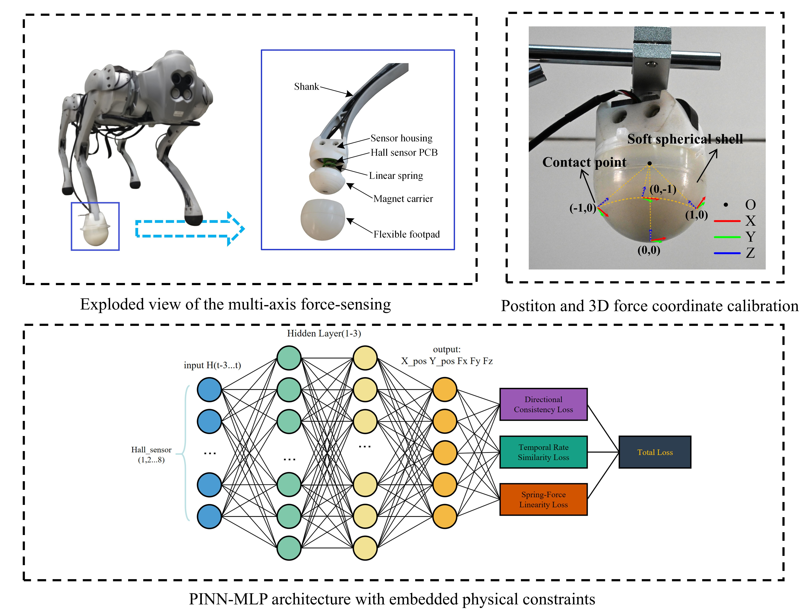
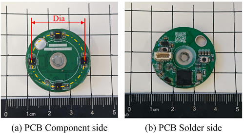
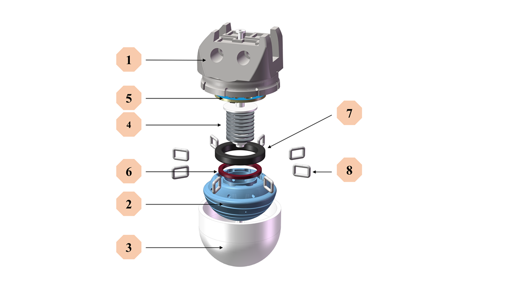

# Catch-Contact-the-Force
A Multi-Contact-Point, Multi-Axis Foot-End Force Sensor for Legged Robots Magnetic-Hall Sensing via Spring Deformation

## Publications

If you use this work in an academic context, please consider citing the following publications:

    @article{meng2025ctf,
      title= {CtF: A Multi-Contact, Multi-Axis Spring--Hall Foot Sensor with Physics-Guided Learning for Legged Robots},
      author       = {Meng, Xin and Lu, Jianning and Ma, Wangjie},
      journal      = {IEEE Sensors Journal},
      year         = {2025},
      publisher    = {IEEE},
      doi          = {10.1109/JSEN.2025.3622594},
      note         = {Manuscript ID: Sensors-96924-2025, Published in Early Access on IEEE Xplore}
    }

## Usage Instructions

I sincerely hope the CtF Foot-End Multi-Dimensional Force Sensor can reach a wide audience and help anyone in need of high-precision foot-ground contact detection or multi-axis force sensing—without being limited by the high cost of traditional strain-gauge-based sensors.

This repository includes:

Hardware: 3D models, titanium spring machining parameters, and material specifications;

Embedded PCB: Based on RP2040/RP2350A + MLX90393, designed in LCSC EDA (an Altium Designer version will be provided in future updates);

Embedded Firmware: For sensor data acquisition and transmission;

PINN + MLP Algorithm Code: Runs on a personal PC for multi-axis force and contact-point estimation.

## How to Use

Hardware and PCB design files are provided in their respective folders;

Embedded firmware can be directly flashed to the RP2040;

Instructions for running the PINN + MLP algorithm are provided in a dedicated documentation file.

If you have any questions, feel free to contact me at: 936915881mxlzy@gmail.com

## PCB

## Structure

## License
Code is licensed under the **PolyForm Noncommercial License 1.0.0**.
Noncommercial use only; commercial use requires a separate license from the author.

## Attribution
Please retain the copyright notice and cite:

Meng, X., Lu, J., Ma, W. (2025). CtF: Multi-Contact, Multi-Axis Foot-End Force Estimation (PINN+MLP).

See `CITATION.cff` for a citation entry.
